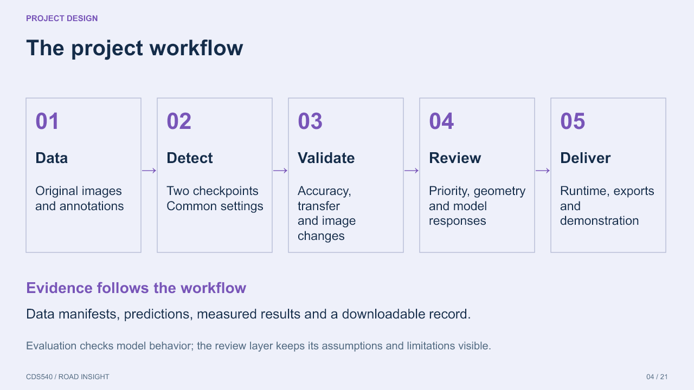
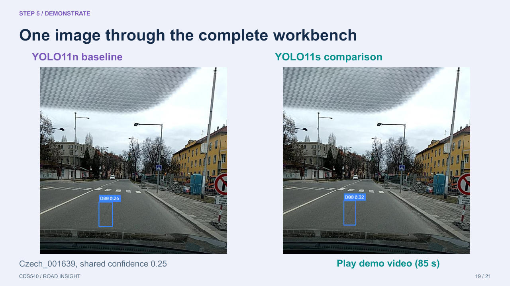

# English presentation and captioned demonstration

The updated presentation replaces the previous deck at the same repository path.

| File | Use |
|---|---|
| [English presentation](../CDS540_Final_Presentation_Deck.pptx) | 21 slides, approximately 14 min 15 sec including the video |
| [Captioned demo](../RoadInsight_Demo_EN.mp4) | 85-second walkthrough of actual local application results |
| [Editable subtitles](../RoadInsight_Demo_EN.srt) | English subtitles, also burned into the video |
| [Speaker notes](英文讲稿与分段.md) | Suggested wording, timing and five optional presentation segments |
| [Handoff guide](先看这里_演示交接.md) | Playback instructions, evaluation scope and pending validation |
| [Asset provenance](素材来源与封面提示词.md) | Original image sources, concept-cover prompt and numerical sources |
| [Output identity](Workspace_Output_Provenance.json) | Case, settings and hashes of the two complete model output PNGs |
| [Render plan](Render_在线演示_待确认.md) | A pending deployment option; no public service has been deployed |

Keep the PPTX and MP4 side by side in `submission/`. Slide 19 links the video using its relative filename. The movie is an external file, not embedded. Test playback on the presentation computer before class. It is an edited walkthrough of real local key views, not an uncut continuous recording; it has English captions and no audio.

The sequence is: project motivation, design goals and principles, workflow, application functions, and then five stages (data, detection, validation, review/diagnostics, and delivery). The deck has no separate Questions page or appendix stack. All body slides use the same light lavender background. Its seven charts and workflow are editable PowerPoint objects.

The demonstrated interface comes from [workbench PR #4](https://github.com/pico0v0/CDS540-RoadDamage-Detectio/pull/4), commit `0ee4096`. Use that branch, or a main branch containing its changes, for the matching live interface. This presentation submission does not change application code, train models, alter dataset partitions, or update the final report. The original deck remains recoverable through Git history.

The underlying data-quality issues, different checkpoint training budgets, cross-computer validation and cloud/embedded measurements remain open. Sources and the distinct protocols for full tests, the 18-image diagnostic and recorded adaptation studies are retained in the notes and handoff guide.

